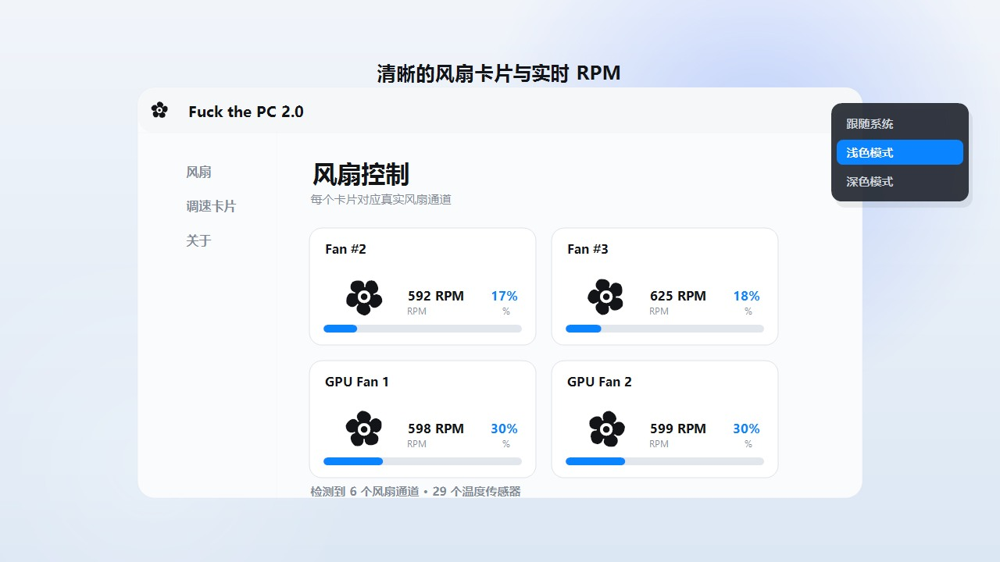
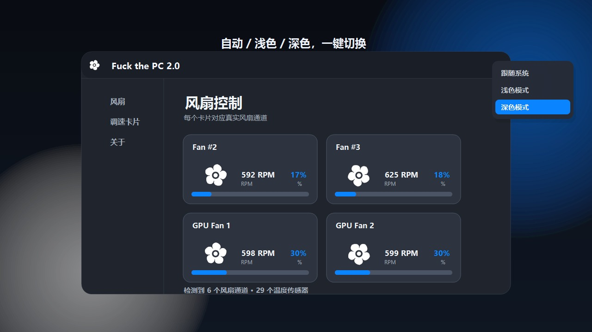
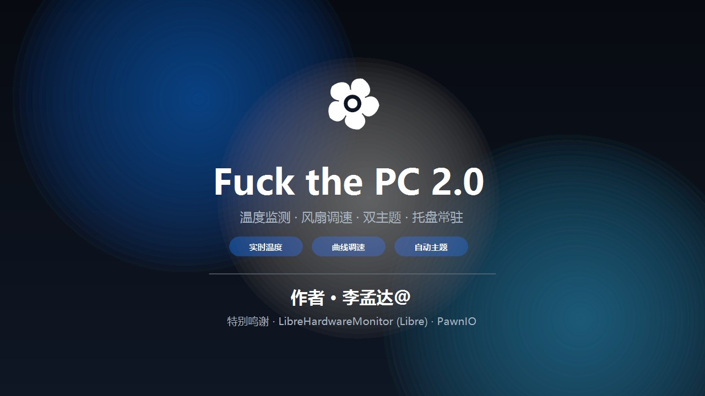

<div align="center">



# Fuck the PC

**一个专注、轻量的 Windows 托盘温度监测与风扇控制工具**

从真实硬件传感器读取温度与转速，支持固定、线性和多点曲线调速。

[](https://www.microsoft.com/windows)
[](https://dotnet.microsoft.com/)
[]()
[]()

[下载软件](https://github.com/2975283747/Fuck-the-PC/releases/latest/download/TrayTemps.exe)
&nbsp;·&nbsp;
[观看 15 秒宣传片](https://github.com/2975283747/Fuck-the-PC/releases/latest/download/FuckThePC-Promo-15s.mp4)
&nbsp;·&nbsp;
[查看源码](https://github.com/2975283747/Fuck-the-PC)

</div>

---

## 它是什么

**Fuck the PC** 是一个常驻 Windows 任务栏托盘的硬件监控与风扇控制工具。

不用打开主窗口，鼠标移到托盘图标上就能看到 CPU / GPU 实时温度。需要调速时，右键托盘图标打开完整风扇控制面板。

程序使用 **LibreHardwareMonitor** 读取主板、CPU 和 GPU 的真实硬件传感器，并使用 **PawnIO** 提供底层硬件访问能力。

> 支持范围取决于主板 Super I/O 或 GPU 驱动是否暴露控制通道。没有转速反馈或控制通道的风扇不会出现在可调速卡片中。

## 功能

| 功能 | 说明 |
| --- | --- |
| 托盘温度 | 鼠标悬停托盘图标即可显示 CPU / GPU 温度 |
| 真实传感器 | 从主板、CPU、GPU 读取硬件温度、RPM 和 PWM 通道 |
| 固定转速 | 为风扇设置固定百分比转速 |
| 线性调速 | 设置最低温度 / 最高温度及其对应转速 |
| 曲线调速 | 自由拖动多点曲线，按温度自动调整风扇转速 |
| 风扇卡片 | 每个有效风扇通道一张卡片，显示 RPM、转速和当前曲线 |
| 风扇开关 | 单独开启或关闭每个风扇控制通道 |
| 暂停保持 | 关闭风扇卡片时冻结当前动画，不重置到初始位置 |
| 卡片管理 | 右键重命名、隐藏或恢复风扇卡片 |
| 卡片分配 | 一张调速卡片可以同时分配给多个风扇 |
| 主题 | 自动跟随 Windows、手动浅色、手动深色 |
| 语言 | 简体中文 / English |
| 自启动 | 使用最高权限计划任务，登录后自动启动 |
| 安全恢复 | 退出程序、关闭风扇或温度失效时恢复主板默认控制 |

## 界面预览

| 浅色模式 | 深色模式 |
| --- | --- |
|  |  |

### 15 秒宣传片

[](https://github.com/2975283747/Fuck-the-PC/releases/latest/download/FuckThePC-Promo-15s.mp4)

宣传片包含温度监测、托盘提示、浅色/深色界面、风扇动画、背景音乐和转场音效。

## 下载与安装

### Windows x64

1. 打开 [Latest Release](https://github.com/2975283747/Fuck-the-PC/releases/latest)。
2. 下载 `TrayTemps.exe`。
3. 双击运行，并在 UAC 提示中点击“是”。
4. 程序会进入任务栏托盘。右键托盘图标选择 **自定义风扇转速**。
5. 如需开机自启动，右键托盘图标勾选 **开机自启动**。

> 程序是自包含单文件版本，不需要额外安装 .NET。首次运行会检查 PawnIO 驱动；如果缺失，会从内置的官方安装组件自动安装。

## 使用

### 查看温度

把鼠标移到任务栏托盘图标上，提示会显示类似：

```text
CPU 48°C   GPU 61°C
```

### 设置风扇

1. 右键托盘图标，打开 **自定义风扇转速**。
2. 等待首次硬件扫描完成。
3. 在 **调速卡片** 页面创建固定、线性或曲线卡片。
4. 回到风扇卡片，选择要分配的调速卡片。
5. 打开风扇卡片右侧开关，开始软件调速。
6. 关闭卡片或退出程序时，默认控制会恢复。

### 曲线调速

打开曲线卡片编辑器后：

- 点击空白区域添加节点。
- 拖动节点改变温度与转速。
- 右键节点删除。
- 曲线会实时平滑预览。

## 系统要求

- Windows 10 / 11，x64
- 管理员权限
- 支持 PawnIO 的 CPU / 主板传感器环境
- 支持 LibreHardwareMonitor 控制通道的主板或 GPU

CPU 温度通常需要底层硬件访问权限。若安全软件拦截 PawnIO 或主板 Super I/O 驱动，CPU 温度可能显示 `--`。

## 从源码构建

需要 Windows x64 和 .NET 8 SDK：

```powershell
winget install Microsoft.DotNet.SDK.8
```

在仓库根目录运行：

```powershell
powershell -ExecutionPolicy Bypass -File .\build.ps1
```

默认会发布自包含单文件版本：

```text
outputs\TrayTemps.exe
```

## 鸣谢

本项目使用以下开源项目提供的硬件访问能力：

- [LibreHardwareMonitor / Libre](https://github.com/LibreHardwareMonitor/LibreHardwareMonitor)
- [PawnIO](https://github.com/namazso/PawnIO)

感谢它们为硬件传感器读取和底层硬件访问提供支持。

## 作者

**李孟达@**

如有问题请联系：`m15550917135@outlook.com`

## License

Copyright © 2026 李孟达. All rights reserved.

未经允许禁止转载。详见 [LICENSE](LICENSE)。

